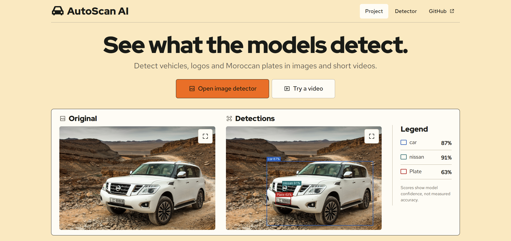

# Vehicle, Logo & Plate Detector

Detect cars, trucks, buses, vehicle brand logos, and Moroccan license plates in images and short videos.

## Live Demo

**[Project page](https://autoscan-ai.netlify.app/)** · **[Image detector](https://autoscan-ai.netlify.app/detect#image)** · **[Video detector](https://autoscan-ai.netlify.app/detect#video)**



## About the Project and Authors

This fork of the [TeamX project](https://github.com/TeamXGroup/cars-logos-plates-detection) provides a browser-based detector with adjustable settings, annotated media, and downloadable detection data. This repository contains the current web app and detection service.

**Sole developer of this fork:** [Nassiri Mosab (MS3B09)](https://github.com/MS3B09).

**Original contributors:** [El-Ouaragli Zayd](https://github.com/zayd8890), [El-Abbass Ossama](https://github.com/ou4abs), [Nassiri Mosab](https://github.com/MS3B09), [Hassan Fares](https://github.com/HaFares), and [Aly Guinga](https://github.com/Guinga6).

## Features

- Upload an image or a video up to 10 seconds long.
- Choose which categories to detect and adjust the confidence threshold.
- Detect cars, trucks, buses, 24 vehicle brands, and Moroccan license plates. Plates are located, not transcribed.
- Review labeled results and download an annotated PNG or MP4, or export detections as CSV or JSON.


## Technologies Used

| Component | Stack |
| --- | --- |
| Web interface | React, TypeScript, Vite |
| Detection service | Python, FastAPI, Gradio, PyTorch, YOLOv8 |
| Media processing | Pillow, OpenCV, PyAV |
| Hosting | Netlify (web interface), Hugging Face Spaces (detection service) |

## Run Locally

Install Node.js 24 and npm, then run:

```sh
git clone https://github.com/MS3B09/autoscan-ai.git
cd autoscan-ai/web
npm ci
```

Create `web/.env.local` with this line:

```dotenv
VITE_AUTOSCAN_API=https://ms3b09-autoscan-ai-images.hf.space
```

From `web/`, start the development server:

```sh
npm run dev -- --port 5173 --strictPort
```

Open [http://127.0.0.1:5173/detect](http://127.0.0.1:5173/detect). The interface runs locally; uploaded media is processed by the hosted service, subject to its availability and shared quota. You do not need Python, model files, or a GPU for this setup. See the [runbook](docs/release-runbook.md#runtime-and-dependencies) to run or deploy the backend.

## Data and Resources

- **Vehicles:** The general YOLOv8 model uses [COCO](https://cocodataset.org/#home) classes for cars, trucks, and buses.
- **Logos:** [LOGOS TEAMX, version 1](https://universe.roboflow.com/ms3b/logos-teamx/dataset/1) covers the 24 brand classes shown above.
- **Plates:** The [plate detection dataset](https://universe.roboflow.com/plate-detection/plate_detection-tp5h9) is used to locate Moroccan license plates.

[Repository license](LICENSE) · [Dataset attribution and terms](web/public/examples/attribution.txt)
